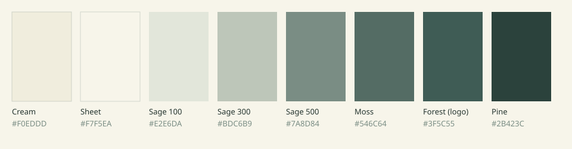

# Esszencia Szépségműhely · Umbrel app

The website of **Esszencia Szépségműhely · Beauty & Relax** (Sénye), packaged as an
[Umbrel](https://umbrel.com) community app store. One static page in four languages
(HU · EN · DE · SV), served by nginx, with no external dependencies: fonts, images
and scripts are all local, so nothing is loaded from Google or any other third party.



## Install on Umbrel

1. Open **App Store** on your Umbrel → **⋯** (top right) → **Community App Stores**.
2. Paste `https://github.com/adm32/esszencia-umbrel` and click **Add**.
3. Open **adm's App Store** and install **Esszencia**.

The site runs on port **4751** (`http://umbrel.local:4751`). It is a public website,
so Umbrel's login screen is switched off for it (`PROXY_AUTH_ADD: "false"`).

To put it on a real domain, point a Cloudflare Tunnel public hostname at
`http://<umbrel-ip>:4751`.

## Editing content

| What | Where |
|---|---|
| Price list & services (all 4 languages) | `adm-esszencia/www/assets/js/services.js` |
| Page texts (Hungarian) | `adm-esszencia/www/index.html` |
| Translations of page texts | `adm-esszencia/www/assets/js/i18n.js` |
| Colours, fonts, layout | `adm-esszencia/www/assets/css/style.css` |
| Photos | `adm-esszencia/www/assets/img/` (WebP) |

**Price list.** Each text can be a plain Hungarian string or an object with all
four languages:

```js
{ name: { hu: "Szemöldökfestés", en: "Brow tint", de: "Augenbrauen färben", sv: "Färgning av bryn" },
  duration: "15 perc",   // "perc" is translated automatically
  price: "2 500 Ft" }    // "Érdeklődj" shows "On request" etc.
```

Missing translations fall back to Hungarian, so a quick Hungarian-only line never breaks anything.

**Page texts.** The page is written in Hungarian. `i18n.js` maps each Hungarian text
to `[English, Deutsch, Svenska]`. If you change a Hungarian sentence in `index.html`,
update its key in `i18n.js` too; otherwise that sentence simply stays Hungarian in the
other languages.

**Language choice.** The site uses, in order: a `?lang=de` link → the visitor's last
choice → their browser language → Hungarian.

After editing, bump `version` in `adm-esszencia/umbrel-app.yml`, push, and update the
app from the Umbrel App Store.

## Palette (from the logo)

| Token | Hex | Use |
|---|---|---|
| Cream | `#F0EDDD` | page background (logo paper) |
| Sheet | `#F7F5EA` | cards, mounted photos |
| Sage 100 | `#E2E6DA` | alternate sections |
| Sage 300 | `#BDC6B9` | soft accents |
| Sage 500 | `#7A8D84` | decorative only |
| Moss | `#4D635C` | small labels (AA-compliant) |
| Forest | `#3F5C55` | logo ink, buttons, dark sections |
| Pine | `#2B423C` | headings |

Fonts: **Jost** (matches the logo's wordmark) and **Cormorant Garamond Italic** for
Latin plant names. Both are self-hosted under the SIL Open Font License.

## Structure

```
umbrel-app-store.yml          store id "adm"
adm-esszencia/
  umbrel-app.yml              Umbrel listing
  docker-compose.yml          nginx:stable-alpine + Umbrel app proxy
  nginx.conf                  gzip, caching, security headers (strict CSP)
  www/                        the website
assets/                       icon, store screenshots, palette
```
